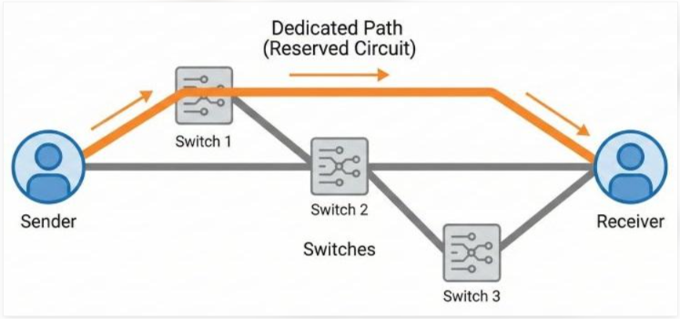
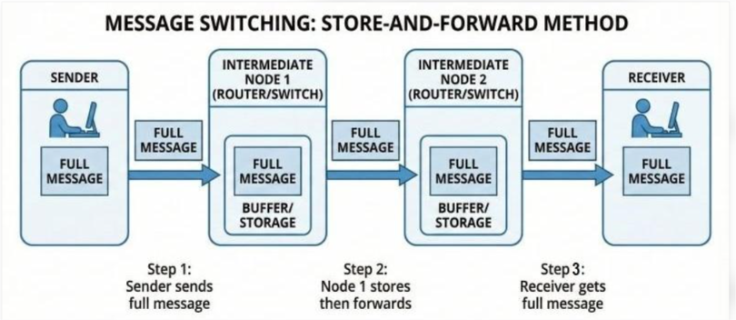
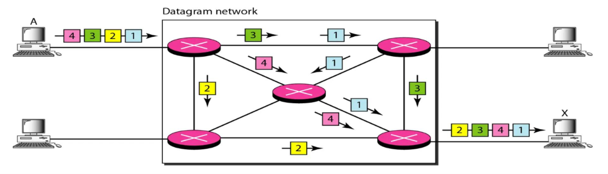
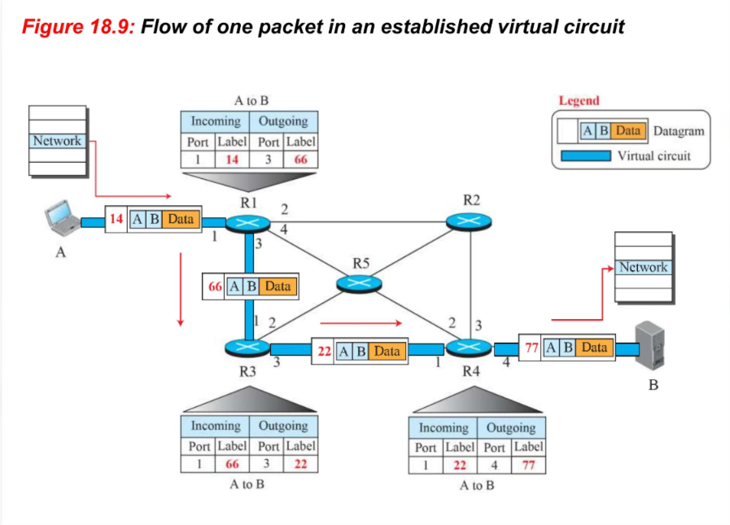
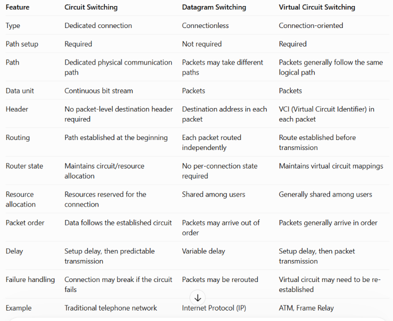

-->Switching: Changing the route/path by a packet or message to find the best route is     
              known as Switching.

-->Types of Switching:
    1: Circuit Switching:
        --> A dedicated communication path is established between the sender and receiver 
            before data transmission begins.
        --> The path remains reserved for the entire communication session.
        --> Example: Traditional landline telephone networks.

    2:Message Switching:
        --> The entire message is treated as one unit and sent from one intermediate node 
            to another.
        --> Each node stores the complete message before forwarding it to the next node. 
            This is called store-and-forward.
        --> No dedicated path is required, but large messages can cause delays.
        --> Example: Historical store-and-forward telegraph systems.

    3: Packet Switching:Packet switching is a technique in which data is divided into 
                        small units called packets, which are transmitted through a shared 
                        network.
        --> Data is divided into small units called packets.
        --> Packets are forwarded through the network and may take different routes. They 
            are reassembled at the destination using sequence numbers.
        --> Network resources are shared among multiple users.
        --> Example: Internet, web browsing, and email.
        -->Types Of Packet Switching:
            1:Datagram Approach:
                --> Each packet is treated independently and can travel through a 
                    different route to reach the destination.
                --> Each packet contains the destination address, allowing routers to 
                    decide where to forward it.
                --> Packets may arrive out of order, be delayed, or get lost. The 
                    destination may need to rearrange them.
                --> No connection or dedicated path is established before transmission.
                --> Example: IP (Internet Protocol), used for sending data across the 
                             Internet.

            
            2:Virtual Circuit Approach:
                --> A logical path called a virtual circuit is established between the
                    sender and receiver before data transmission begins/each packet
                    transmission.
                --> All packets generally follow the same established route and carry a
                    virtual circuit identifier (VCI) instead of needing the full 
                    destination address at every hop.
                --> Each router uses its VCI mapping table to determine the next hop and 
                    the outgoing VCI.
                --> Routers maintain information about the virtual circuit to forward 
                    packets along the established path.
                --> Packets generally arrive in order because they follow the same path, 
                    although failures can disrupt delivery.
                --> Example: Frame Relay and ATM networks.

-->Difference between Circuit Switching, Datagram Switching and Virtual Circuit Switching:
